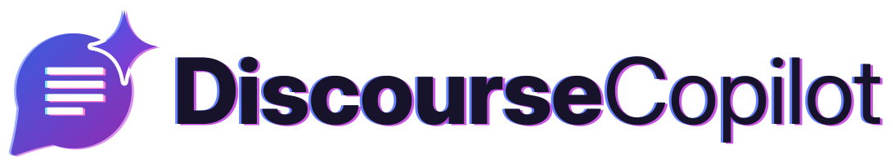
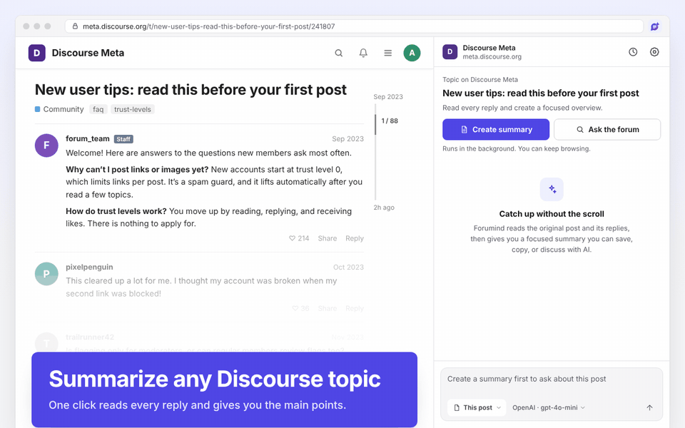
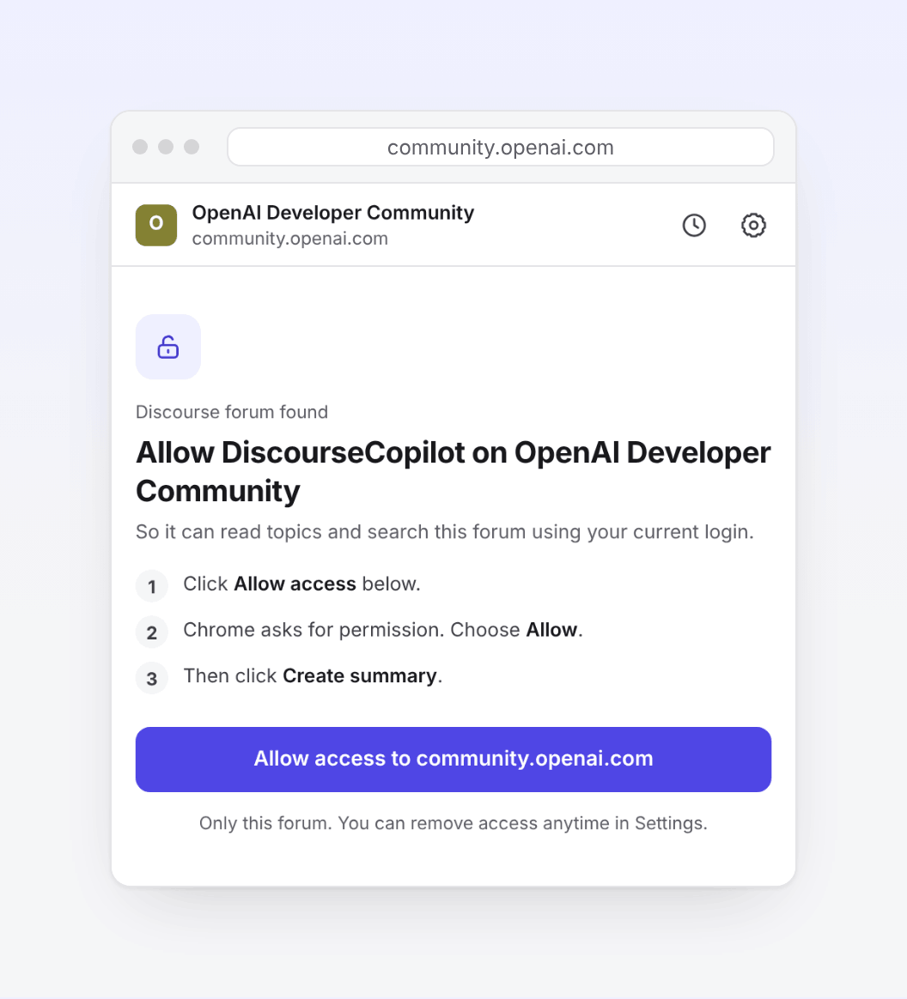
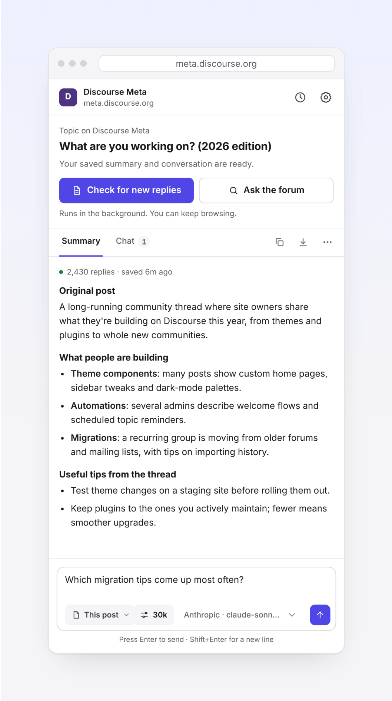
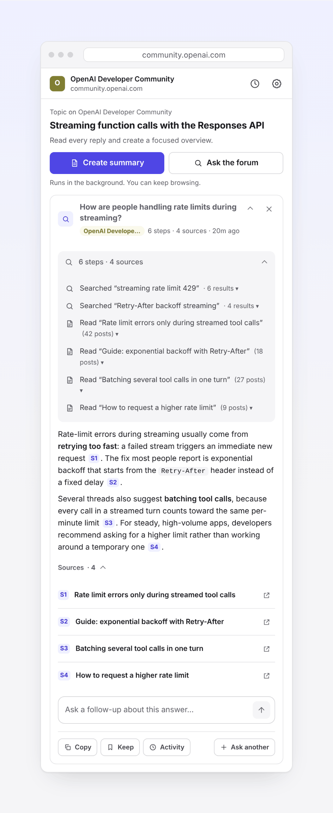
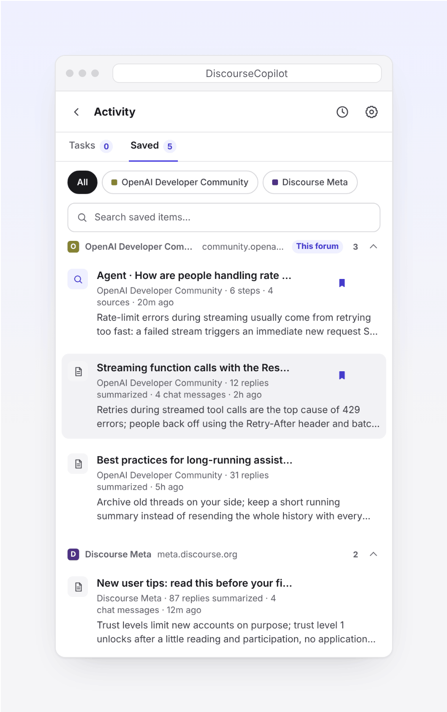
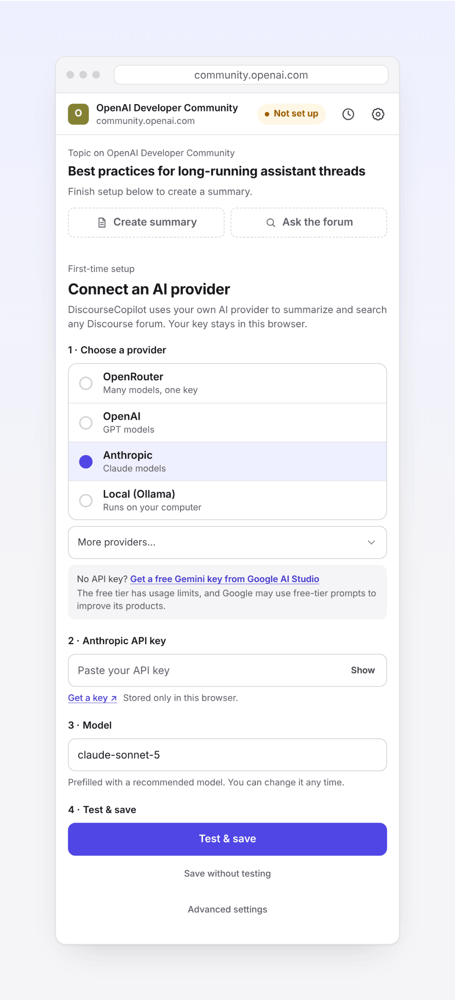
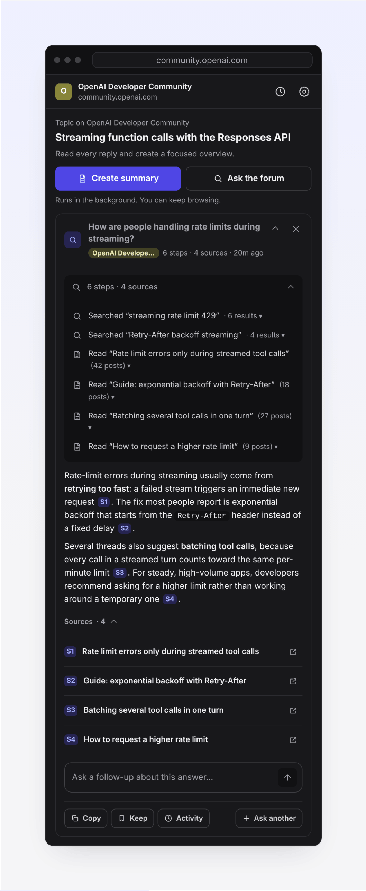
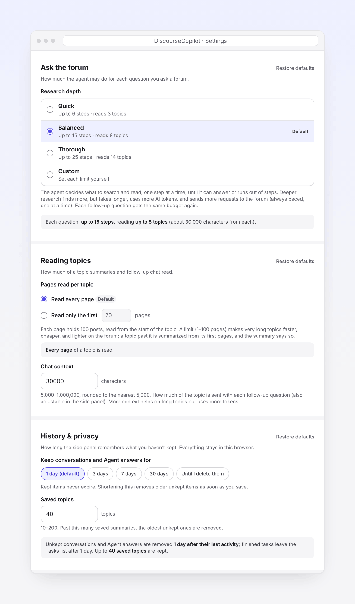

<h1 align="center">
  <picture>
    <source media="(prefers-color-scheme: dark)" srcset="assets/brand/wordmark/discoursecopilot-wordmark-horizontal-on-dark.svg">
    
  </picture>
</h1>

<h3 align="center">几秒钟看懂任何 Discourse 论坛的长帖。</h3>

<a href="README.md">English</a> · <b>简体中文</b>

  一键总结长帖，针对整栋楼追问，还能让 AI 帮你搜遍整个论坛，回答附带原帖链接。

  
  
  
  

  
  &nbsp;
  

  <a href="https://github.com/kccarlos/DiscourseCopilot"><b>⭐ 在 GitHub 上点个 Star</b></a>
  ，第一时间收到新版本。不花钱，还能让更多逛论坛的人发现它。

DiscourseCopilot 是一个免费、开源的 Chrome 扩展。它在浏览器侧边栏里打开，配合任何基于 Discourse 搭建的论坛使用，比如 [LINUX DO](https://linux.do)、[美卡论坛](https://www.uscardforum.com)、[meta.discourse.org](https://meta.discourse.org)、[community.openai.com](https://community.openai.com)，或者你自己的社区。AI 由你自己提供（用你自己的 API key，或者跑在你电脑上的本地模型），**扩展本身没有服务器、没有账号、没有任何统计**，详见[隐私优先](#隐私优先)。

## 隐私优先

DiscourseCopilot 的设计原则是：你看了什么，只有你自己知道。

- **没有统计、没有追踪、没有账号。** 没有任何遥测，也不用注册。
- **没有 DiscourseCopilot 服务器。** 什么都不会发给开发者，因为根本没有地方可发。
- **数据只存在你的浏览器里。** 设置、API key、保存的总结、对话和回答都只保存在你的电脑上。
- **只有两类网络请求：**
  1. **你允许的论坛**：用你在论坛上已有的登录状态读帖子和搜索。按论坛逐个授权，随时可以在设置里移除。
  2. **你选的 AI 服务商**：用你自己的 key。它会收到你要问的论坛内容和你的问题。**如果用本地模型（Ollama 或 LM Studio），数据完全不离开你的电脑**（除非你把它指向别的机器上的服务）。
- **你的 key 只发给它自己的服务商。** 包括获取模型列表的请求。

更多细节，包括存了什么、存多久，见[隐私政策](PRIVACY.md)（英文）。代码完全开源，你可以自己检查。

## 为什么好用

- **不用爬楼。** 几百楼的帖子，直接看要点。
- **针对整栋楼提问。** 每一层楼都会放进对话上下文，而不是只搜几条相关结果，所以你可以问"大家最后怎么定的？"或者"哪一层楼提到了解决办法？"，回答会告诉你是哪几层说的。
- **搜遍整个论坛。** 提一个问题，AI 会一步一步地搜索、阅读相关帖子，最后给出带编号来源的回答，点一下就能跳到原帖。整个过程你都看得到，还能继续追问。
- **专为 Discourse 论坛打造。** 每个论坛授权一次就行，不需要其他设置。
- **AI 随你选。** OpenAI、Anthropic（Claude）、Google Gemini 等都支持（见[下面的列表](#选择-ai-服务商)），也可以用电脑上免费运行的本地模型。
- **后台运行，不用等。** 任务在后台跑，你可以继续看别的帖子，回来再看结果。
- **答案可以核对。** AI 也会出错。总结和回答都链接回原帖，重要的内容你可以自己确认。

## 支持哪些论坛

所有基于 [Discourse](https://www.discourse.org) 搭建的论坛都可以用，不管是什么域名，也包括需要登录的私有社区。下面是一些常见的 Discourse 论坛：

[美卡论坛 US Card Forum](https://www.uscardforum.com)、[LINUX DO](https://linux.do)、[Discourse Meta](https://meta.discourse.org)、[OpenAI 开发者社区](https://community.openai.com)、[Cursor 论坛](https://forum.cursor.com)、[Hugging Face 论坛](https://discuss.huggingface.co)、[PyTorch 论坛](https://discuss.pytorch.org)、[Python 社区](https://discuss.python.org)、[Rust 用户论坛](https://users.rust-lang.org)、[Swift 论坛](https://forums.swift.org)、[Obsidian 论坛](https://forum.obsidian.md)、[Home Assistant 社区](https://community.home-assistant.io)、[Docker 社区论坛](https://forums.docker.com)、[Unity 讨论区](https://discussions.unity.com)、[Godot 论坛](https://forum.godotengine.org)、[n8n 社区](https://community.n8n.io)，以及成千上万个其他社区。

不确定某个论坛是不是 Discourse？打开它，点一下 DiscourseCopilot 图标，侧边栏会告诉你。以上论坛仅作举例，DiscourseCopilot 与它们没有任何关联。各论坛自己的规则仍然有效，人机验证比较严格的论坛可能会拦截部分请求（见[常见问题](#常见问题)）。

## 三步上手

**1. 安装扩展。**
打开 [Chrome 应用商店里的 DiscourseCopilot](https://chromewebstore.google.com/detail/discoursecopilot/dpngnaiiofobfjleabbhnfmdflddnhac)，点 **添加至 Chrome**。用 Microsoft Edge 的话，打开 [Edge 加载项商店里的 DiscourseCopilot](https://microsoftedge.microsoft.com/addons/detail/cjbpgigbkfdcgdmlpifklpoklpnbkhmp)，点 **获取**。然后点工具栏上的拼图图标，把 **DiscourseCopilot** 固定在工具栏上，方便随时打开。

> **关于商店更新。** 每个新版本都要经过 Google 或微软审核，才能在 Chrome 应用商店或 Edge 加载项商店上架，耗时从几小时到几天不等，所以商店里的版本可能比最新的 [GitHub Release](https://github.com/kccarlos/DiscourseCopilot/releases/latest) 稍旧。想马上用最新版，可以从 GitHub 安装 zip（见下方）。商店版审核通过后浏览器会自动更新。

想马上用最新版？从 GitHub 安装

1. 打开 [Releases 页面](https://github.com/kccarlos/DiscourseCopilot/releases)，下载最新的 `discourse-copilot-<version>.zip`。
2. 解压。
3. 在 Chrome 中打开 `chrome://extensions`（Edge 中是 `edge://extensions`），打开右上角的 **开发者模式**。
4. 点 **加载已解压的扩展程序**，选择解压后的文件夹。
5. 点工具栏上的拼图图标，固定 **DiscourseCopilot**。

这样安装的扩展不会自动更新。要更新时，下载新的 zip，替换文件夹里的文件，再到 `chrome://extensions` 里点扩展卡片上的刷新图标。Chrome 启动时可能会提示"开发者模式"，这是正常的。

**2. 连接一个 AI 服务商。**
点 DiscourseCopilot 图标打开侧边栏。设置卡片会让你选服务商、粘贴 API key、选模型（会根据服务商当前提供的模型自动推荐一个，通常是又快又便宜的那种）。不知道选哪个，可以看[选择 AI 服务商](#选择-ai-服务商)。**没有 API key？** 去 [Google AI Studio](https://aistudio.google.com/apikey) 一分钟就能免费拿到一个 Gemini key，设置卡片里也有链接。免费额度有用量限制，Google 可能会用免费版的请求内容改进其产品。

**3. 打开一个论坛帖子，授权访问，然后点“总结贴文”。**
打开任意 Discourse 论坛的帖子（如果需要登录，先登录），点 DiscourseCopilot 图标。第一次在某个论坛使用时，侧边栏会显示 **在 *论坛名* 上启用 DiscourseCopilot**：点 **允许访问**，然后在 Chrome 弹窗里选 **允许**。之后点 **总结贴文** 就行。每个论坛只需要授权一次，之后论坛页面右下角也会出现 DiscourseCopilot 按钮。

如果当前页面不是 Discourse 论坛，侧边栏会告诉你，并推荐几个可以试试的论坛。

> 扩展界面提供英文和简体中文两种语言，会跟随浏览器的语言自动切换。下文的按钮名称以中文界面为准。总结和回答默认跟随帖子的语言，中文帖子就用中文回答，也可以在设置里指定语言。

## 能做什么

<table>
  <tr>
    <td width="50%" valign="top">
      
      
<strong>总结贴文与追问</strong> 
      看到主楼内容、大家的回应和关键结论，再长的帖子也行（默认读完所有页，所以特别长的帖子会慢一些，也会多用一些 token）。然后可以继续追问。

    </td>
    <td width="50%" valign="top">
      
      
<strong>全站搜索</strong> 
      提一个问题，AI 会搜索论坛、阅读最相关的帖子，每一步你都看得到，最后给出带 [S1] 这样来源编号的回答，点一下就跳到原帖。回答下面可以直接追问。

    </td>
  </tr>
  <tr>
    <td width="50%" valign="top">
      
      
<strong>按论坛分组的历史记录</strong> 
      保存的总结、对话和回答按论坛分开，不同社区不会混在一起。想长期保留的可以点 **保留**。

    </td>
    <td width="50%" valign="top">
      
      
<strong>快速设置</strong> 
      选服务商、粘贴 key、点 <strong>Test &amp; save</strong>。有问题会马上提示你。

    </td>
  </tr>
  <tr>
    <td width="50%" valign="top">
      
      
<strong>深色模式</strong> 
      自动跟随系统的浅色或深色主题。

    </td>
    <td width="50%" valign="top">
      
      
<strong>可以自己调的设置</strong> 
      全站搜索的深度、长帖读多少页、历史记录保留多久，都可以自己选。

    </td>
  </tr>
</table>

提问都在侧边栏底部的输入框里：选 **此帖子** 就当前话题和总结提问，选 **整个论坛** 则搜索整个论坛。输入框里也会显示当前用的是哪个 AI 服务商和模型；如果在设置里收藏了几个常用模型，可以直接在那里切换。

## 使用全站搜索

1. 在论坛页面点 **全站搜索**（或在输入框里选 **整个论坛**），输入你想知道的问题（比如"大家对 X 怎么看？"或者"这周有什么新消息？"）。
2. 侧边栏会实时显示 AI 的每一步：搜了什么关键词、读了哪些帖子、各有多少楼。展开某一步可以看到它为什么这么做、得到了什么结果。点 **停止** 可以随时停止。
3. 回答会附带 [S1] 这样的编号来源，点一下跳到对应的来源卡片，卡片链接到原帖。
4. 在回答下面可以**继续追问**，会在同一个论坛、同一段对话里继续，并重新获得一份搜索额度。

AI 只能读，不能写：它的工具只能搜索、列出和阅读帖子，以及查看你保存的总结，没有任何工具可以发帖或修改论坛内容。论坛内容作为引用材料交给模型，并要求模型不要执行其中的指令（写得很巧妙的文本仍然可能误导模型，这也是 AI 没有任何写入工具的原因）。因为 AI 每次只按固定格式执行一个动作，能力强一些的模型效果更好，很小的本地模型可能跟不上。

## 选择 AI 服务商

DiscourseCopilot 不自带 AI。你可以连接一个已经在用的服务商，或者新注册一个。

| 服务商 | 需要什么 | 说明 |
| --- | --- | --- |
| OpenRouter | API key | 一个 key 就能用很多模型 |
| OpenAI | API key | GPT 系列模型 |
| Anthropic | API key | Claude 系列模型 |
| Google Gemini | API key | Gemini 系列模型（[Google AI Studio](https://aistudio.google.com/apikey) 可免费获取 key，有用量限制） |
| Groq | API key | 速度很快的开源模型 |
| xAI | API key | Grok 系列模型 |
| DeepSeek | API key | DeepSeek 系列模型 |
| Ollama | 在电脑上安装 Ollama | 在本机运行，不需要 key，也不产生费用 |
| LM Studio | 在电脑上安装 LM Studio | 在本机运行，不需要 key，也不产生费用 |

**拿不定主意？** 已经在为其中某家付费，就用那家。想用一个 key 试很多模型，OpenRouter 是个简单的开始。

粘贴 key 之后，模型栏会列出这个服务商当前提供的模型，并自动选一个适合做总结的、又快又便宜的模型。你随时可以换。

在电脑上使用 Ollama

启动 Ollama，然后在设置里选 **本地 (Ollama)**。不需要改任何 Ollama 设置：扩展会自动处理 Ollama 默认会拒绝的那个浏览器请求头。地址默认填好 `http://localhost:11434`，LM Studio 默认是 `http://localhost:1234`。如果服务跑在另一台电脑上，填它的地址即可；点 **测试并保存** 时 Chrome 会请求一次连接权限。

## 自定义

在侧边栏里打开 **设置**，它会直接在侧边栏内显示，不用再关额外的标签页（在 `chrome://extensions` 里的扩展 **选项** 页面显示的是同一份设置）。可以调整：AI 服务商和模型、收藏的模型、回答语言（默认“自动”，跟随帖子语言）、自定义提示词、全站搜索深度、长帖读取页数、追问时带多少上下文、历史记录保留时间、已授权的论坛，以及是否在论坛页面显示悬浮按钮。每一项的详细说明见[英文 README 的 Customize 部分](README.md#customize)。

## 常见问题

**所有 Discourse 论坛都能用吗？需要登录的论坛呢？**
一般都能用，但论坛自己的设置仍然有效。DiscourseCopilot 用你浏览器里的登录状态读论坛，所以你登录后能看到的内容，它也能读到。有些论坛会限制部分用户的搜索或阅读、限制读取速度，或者弹出自动请求过不去的人机验证，这时总结或回答可能不完整，或者失败。如果论坛要求你登录或通过验证，请在普通标签页里完成。全站搜索会暂停等待，完成后点 **继续**；总结的话，再点一次 **总结贴文** 就行。

**提示需要验证（"The forum requires verification"），但我打开网站并没有看到验证？**
这通常是 Cloudflare 把你的网络流量当成了机器人，用代理或 VPN 时很常见。可以在浏览器里直接打开 `https://论坛域名/t/1.json` 看看：如果这里也出现验证页面，就是网络环境的问题，换个节点或者先在这个页面通过验证再试。

**为什么要逐个论坛授权？**
Discourse 论坛分布在成千上万个不同的网站上，扩展没法提前知道。与其在安装时就要求"读取和更改你在所有网站上的数据"，不如在你第一次使用某个论坛时，只请求这一个论坛的权限。授权后，它可以用你的登录状态在后台读帖子和搜索（切换标签页后也能继续）。所有已授权的论坛都可以在 **设置 → 论坛访问** 里查看和移除，移除后保存的总结和回答不会被删除。

**我看到"rate limit"提示怎么办？**
有两种情况。如果是*论坛*要求放慢速度，侧边栏会显示"Forum asked us to slow down"，稍等一会儿会自动重试，你什么都不用做。如果是你的 *AI 服务商*在限速，等一分钟再试，并检查你的套餐和用量。免费额度经常被限速的话，在侧边栏底部的输入框里一键切换到另一个模型就好。

**怎么隐藏论坛页面上的 DiscourseCopilot 按钮？**
打开设置，滚动到 **论坛访问**，关掉 **在论坛页面上显示 DiscourseCopilot 按钮**，然后点 **保存设置**。已打开的论坛标签页上的按钮会马上消失，工具栏图标仍然可以打开侧边栏。

**Ollama 报错“Ollama 拒绝了连接（403）”。**
DiscourseCopilot 会去掉它自己发往 `localhost`、`127.0.0.1` 和你允许的本地服务地址的请求里的 `Origin` 请求头，这样默认安装的 Ollama 就能接受。网页发的请求不受影响。如果仍然看到 403，请更新 Ollama 并重新加载扩展；实在不行，可以用 `OLLAMA_ORIGINS=chrome-extension://*` 启动 Ollama。

**会发送哪些数据，发给谁？**
只有完成你的请求所需的论坛内容和你的问题，发给你设置的 AI 服务商（或你的本地模型服务）。什么都不会发给我们。论坛会收到读取帖子和搜索的请求，这些请求从你的浏览器发出，带着你的登录状态，和你平时浏览时浏览器发的请求一样，所以论坛管理员可能在日志里看到它们。

**收费吗？**
扩展本身免费。你的 AI 服务商可能按用量收费，通常每次总结只要很少的钱。本地模型（Ollama、LM Studio）完全免费。

**不小心删错了东西。**
8 秒内点侧边栏底部提示里的 **撤销**（或者在不输入文字时按 Ctrl+Z，Mac 上是 ⌘Z）。超过 8 秒或者关掉侧边栏后，删除就无法恢复了。

**怎么保留某个回答或对话？**
点它上面的 **保留**。保留的内容永远不会过期。你也可以在设置里延长历史记录的保留时间。

**API key 好像有问题。**
打开设置，检查 key 和模型，点 **测试连接**。也确认一下你的服务商账户里还有余额。

更多问题见[英文 README 的 FAQ](README.md#faq)。

## 开发者

- 构建、测试和代码结构：[DEVELOPMENT.md](DEVELOPMENT.md)（英文）
- 参与贡献：[CONTRIBUTING.md](CONTRIBUTING.md)
- 报告安全问题：[SECURITY.md](SECURITY.md)
- 每个版本的更新内容：[CHANGELOG.md](CHANGELOG.md)

欢迎提 Issue 和 PR，中文英文都可以。

## 许可证

Apache License 2.0，见 [LICENSE](LICENSE)。作者 [kccarlos](https://github.com/kccarlos)。

如果 DiscourseCopilot 帮你省了时间，欢迎在 GitHub 上[点个 ⭐ Star](https://github.com/kccarlos/DiscourseCopilot)，这能帮助更多逛论坛的人发现它。
