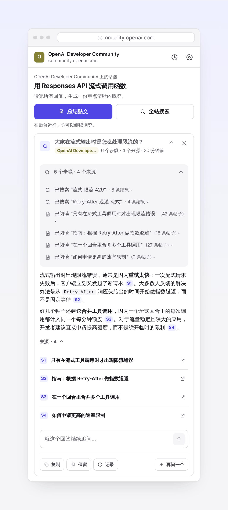
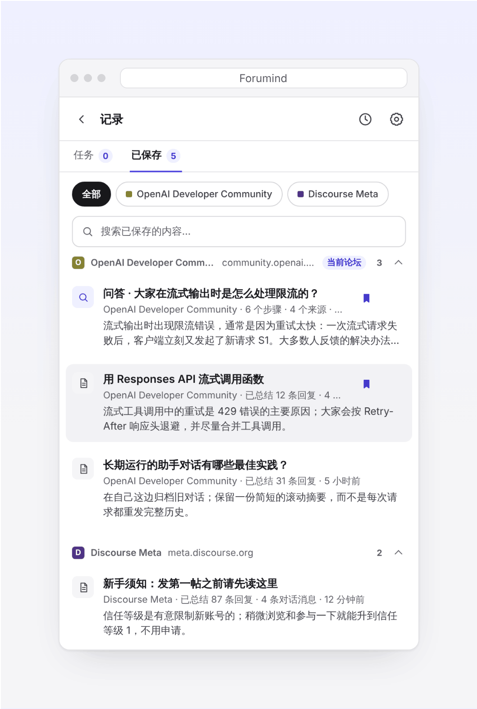
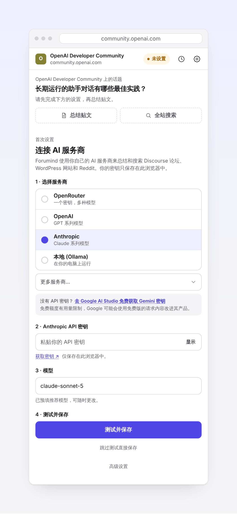
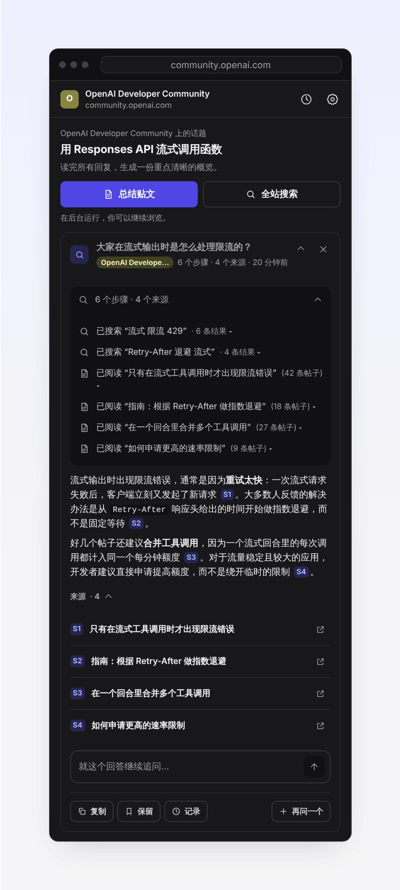
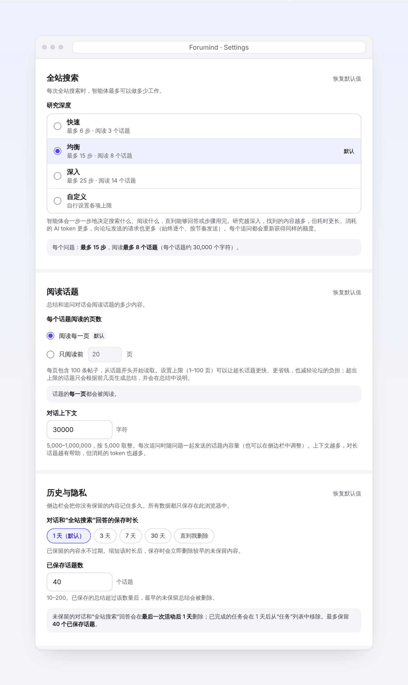

<h1 align="center">
  <picture>
    <source media="(prefers-color-scheme: dark)" srcset="assets/brand/wordmark/forumind-wordmark-horizontal-on-dark.svg">
    
  </picture>
</h1>

<h3 align="center">你的评论区 AI 助手</h3>

<i>Forumind（原 DiscourseCopilot）</i>

<a href="README.md">English</a> · <b>简体中文</b> · <a href="README.zh-TW.md">繁體中文</a>

  一键爬楼总结，针对整栋楼追问（连是哪一层楼说的都告诉你），还能让 AI 帮你搜遍整个论坛，回答附带原帖链接。

  
  
  
  
  
  

  
  &nbsp;
  

  <a href="https://github.com/kccarlos/DiscourseCopilot"><b>⭐ 在 GitHub 上点个 Star</b></a>
  ，第一时间收到新版本。不花钱，还能让更多逛论坛的人发现它。

Forumind 是一个免费、开源的 Chrome 扩展。它在浏览器侧边栏里打开，配合任何基于 Discourse 搭建的论坛、WordPress 网站（比如 Doctor of Credit）和 Reddit 帖子使用，并且**用你自己的论坛登录状态读帖**。AI 由你自己提供（用你自己的 API key，或者跑在你电脑上的本地模型），**扩展本身没有服务器、没有账号、没有任何统计**。

## 支持哪些网站

### Discourse 论坛

所有基于 [Discourse](https://www.discourse.org) 搭建的论坛都可以用，不管是什么域名，也包括需要登录的私有社区。下面是一些常见的 Discourse 论坛：

[美卡论坛 US Card Forum](https://www.uscardforum.com)、[LINUX DO](https://linux.do)、[Discourse Meta](https://meta.discourse.org)、[OpenAI 开发者社区](https://community.openai.com)、[Cursor 论坛](https://forum.cursor.com)、[Hugging Face 论坛](https://discuss.huggingface.co)、[PyTorch 论坛](https://discuss.pytorch.org)、[Python 社区](https://discuss.python.org)、[Rust 用户论坛](https://users.rust-lang.org)、[Swift 论坛](https://forums.swift.org)、[Obsidian 论坛](https://forum.obsidian.md)、[Home Assistant 社区](https://community.home-assistant.io)、[Docker 社区论坛](https://forums.docker.com)、[Unity 讨论区](https://discussions.unity.com)、[Godot 论坛](https://forum.godotengine.org)、[n8n 社区](https://community.n8n.io)，以及成千上万个其他社区。

### WordPress 网站

使用 WordPress 原生评论、并且开放公开 REST API 的 WordPress 网站。已验证可用：[Doctor of Credit](https://www.doctorofcredit.com)、[美卡指南 US Credit Card Guide](https://www.uscreditcardguide.com)、[Frequent Miler](https://frequentmiler.com)、[View from the Wing](https://viewfromthewing.com)、[One Mile at a Time](https://onemileatatime.com)、[Miles to Memories](https://milestomemories.com)、[9to5Mac](https://9to5mac.com)。评论由第三方系统（如 Disqus）提供，或者关闭了 REST API 的网站（比如 The Points Guy、TechCrunch）暂不支持。

### Reddit

在登录 Reddit 的状态下，可以读取帖子及其全部评论；“全站搜索”会在某个版块（subreddit）内搜索。

不确定某个网站能不能用？打开它，点一下 Forumind 图标，侧边栏会告诉你。以上网站仅作举例，Forumind 与它们没有任何关联。各论坛自己的规则仍然有效，人机验证比较严格的论坛可能会拦截部分请求（见[常见问题](docs/zh-CN/faq.md)）。

## 为什么好用

- **不用爬楼。** 几百楼的帖子，一键读完，直接看要点。
- **针对整栋楼提问。** 每一层楼都会放进对话上下文，而不是只搜几条相关结果，所以你可以问"大家最后怎么定的？"或者"哪一层楼提到了解决办法？"，回答会告诉你是哪一层楼说的，方便回去核对。
- **搜遍整个论坛。** 提一个问题，AI 会一步一步地搜索、阅读相关帖子，最后给出带编号来源的回答，点一下就能跳到原帖。不做伸手党，直接问 AI。
- **你能看到的，它都能读。** 用你的论坛登录状态读帖和搜索，只有登录用户（或达到一定等级）才能看的帖子也包括在内，这些内容是搜索引擎和公开的 AI 工具看不到的。
- **不给论坛添负担。** 总结和对话按帖子保存在本地；帖子有了新回复，只抓取新增的部分，不会重复爬整栋楼。
- **后台运行，不用等。** 总结和提问都在后台跑，你可以接着看别的帖子，回来再看结果。
- **AI 随你选。** OpenAI、Anthropic（Claude）、Google Gemini 等都支持，也可以用电脑上免费运行的本地模型。免费额度被限速了？在输入框里一键换个模型接着用。
- **界面支持中文。** 提供简体中文、繁体中文和英文，跟随浏览器语言自动切换。

## 能做什么

<table>
  <tr>
    <td width="50%" valign="top">
      
      
<strong>总结贴文与追问</strong> 
      一键爬楼，看到主楼内容、大家的回应和关键结论，再长的帖子也行。然后继续追问，AI 能看到整栋楼，会告诉你是哪一层楼说的。

    </td>
    <td width="50%" valign="top">
      
      
<strong>全站搜索</strong> 
      提一个问题，AI 会搜索论坛、阅读最相关的帖子，每一步你都看得到，最后给出带 [S1] 这样来源编号的回答，点一下就跳到原帖。回答下面可以直接追问。

    </td>
  </tr>
  <tr>
    <td width="50%" valign="top">
      
      
<strong>按论坛分组的历史记录</strong> 
      保存的总结、对话和回答按论坛分开，不同社区不会混在一起。想长期保留的可以点 <strong>保留</strong>。

    </td>
    <td width="50%" valign="top">
      
      
<strong>快速设置</strong> 
      选服务商、粘贴 key、点 <strong>测试并保存</strong>。有问题会马上提示你。

    </td>
  </tr>
  <tr>
    <td width="50%" valign="top">
      
      
<strong>深色模式</strong> 
      自动跟随系统的浅色或深色主题。

    </td>
    <td width="50%" valign="top">
      
      
<strong>可以自己调的设置</strong> 
      全站搜索的深度、长帖读多少页、历史记录保留多久，都可以自己选。

    </td>
  </tr>
</table>

## 三步上手

**1. 安装扩展。**
打开 [Chrome 应用商店里的 Forumind](https://chromewebstore.google.com/detail/discoursecopilot/dpngnaiiofobfjleabbhnfmdflddnhac)，点 **添加至 Chrome**；用 Microsoft Edge 的话，打开 [Edge 加载项商店](https://microsoftedge.microsoft.com/addons/detail/cjbpgigbkfdcgdmlpifklpoklpnbkhmp)。然后点工具栏上的拼图图标，固定 **Forumind**。（商店版本需要审核，想马上用最新版可以[从 GitHub 安装](docs/zh-CN/guide.md#从-github-安装最新版)。）

**2. 连接一个 AI 服务商。**
点 Forumind 图标打开侧边栏，选服务商、粘贴 API key，点 **测试并保存**，会自动选一个又快又便宜的模型。**没有 API key？** 去 [Google AI Studio](https://aistudio.google.com/apikey) 一分钟就能免费拿到一个 Gemini key。不知道选哪家，见[选择 AI 服务商](docs/zh-CN/guide.md#选择-ai-服务商)。

**3. 打开一个论坛帖子，授权访问，然后点“总结贴文”。**
打开任意 Discourse 论坛的帖子（如果需要登录，先登录），点 Forumind 图标。第一次在某个论坛使用时，点 **允许访问**，再在 Chrome 弹窗里选 **允许**，每个论坛只需授权一次。之后点 **总结贴文**，在底部的输入框里继续追问就行。

## 隐私优先

- **没有统计、没有追踪、没有账号，也没有 Forumind 服务器。** 什么都不会发给开发者，因为根本没有地方可发。
- **数据只存在你的浏览器里。** 设置、API key、保存的总结、对话和回答都只保存在你的电脑上，随时可以删除。
- **只有两类网络请求：** 你允许的论坛（按论坛逐个授权，用你在论坛上的登录状态），以及你选的 AI 服务商（用你自己的 key）。**用本地模型（Ollama 或 LM Studio）时，数据完全不离开你的电脑。**

详见[隐私说明](docs/zh-CN/guide.md#隐私说明)和[隐私政策](PRIVACY.md)（英文）。代码完全开源，你可以自己检查。

## 了解更多

- [使用指南](docs/zh-CN/guide.md)：侧边栏、全站搜索、AI 服务商和 Ollama、每一项设置
- [常见问题](docs/zh-CN/faq.md)：需要登录的论坛、限速、人机验证、撤销删除、费用等

## 开发者

- 构建、测试和代码结构：[DEVELOPMENT.md](DEVELOPMENT.md)（英文）
- 参与贡献：[CONTRIBUTING.md](CONTRIBUTING.md)
- 报告安全问题：[SECURITY.md](SECURITY.md)
- 每个版本的更新内容：[CHANGELOG.md](CHANGELOG.md)

欢迎提 Issue 和 PR，中文英文都可以。

## 许可证

Apache License 2.0，见 [LICENSE](LICENSE)。作者 [kccarlos](https://github.com/kccarlos)。

如果 Forumind 帮你省了时间，欢迎在 GitHub 上[点个 ⭐ Star](https://github.com/kccarlos/DiscourseCopilot)，这能帮助更多逛论坛的人发现它。
