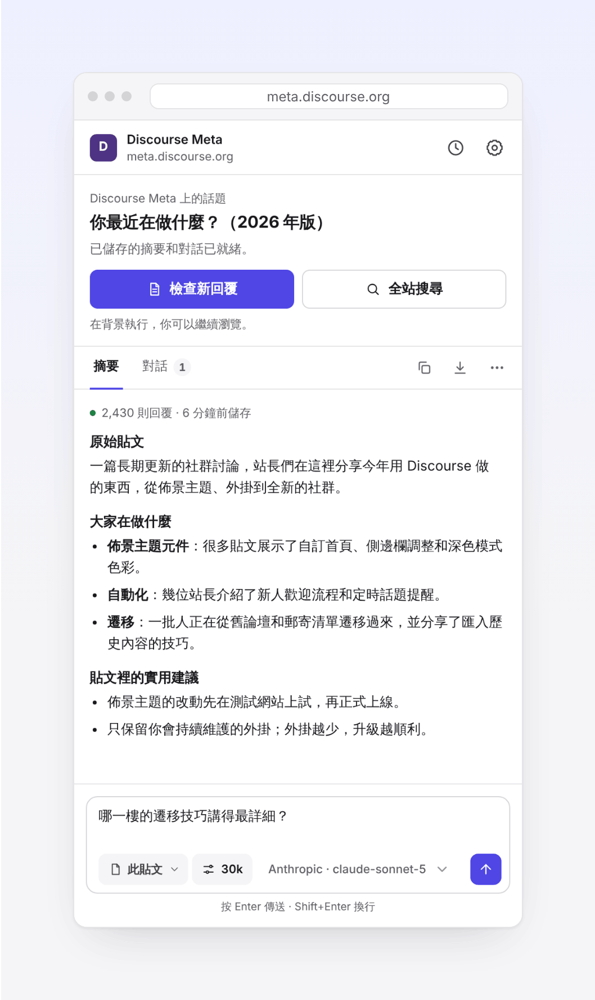
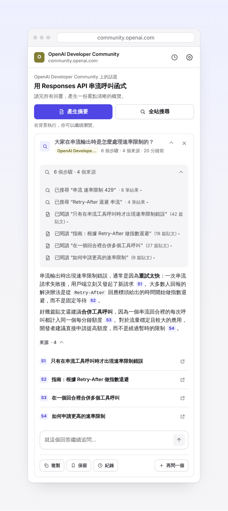
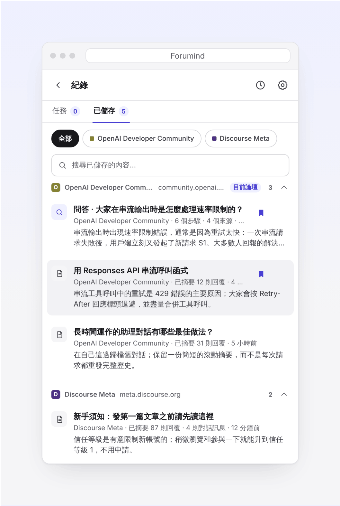
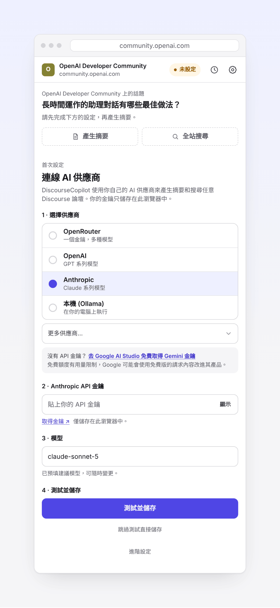
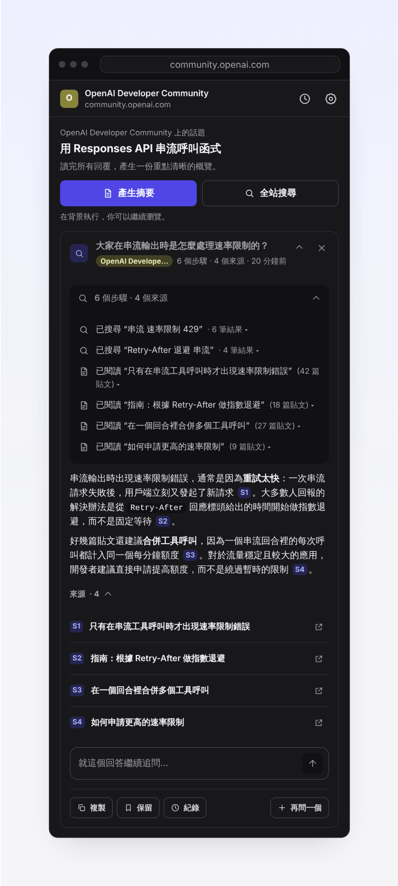
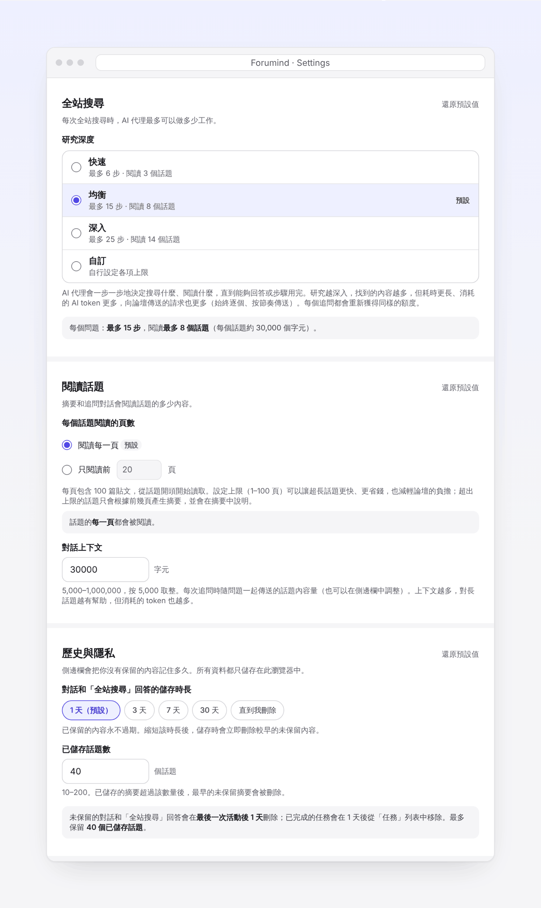
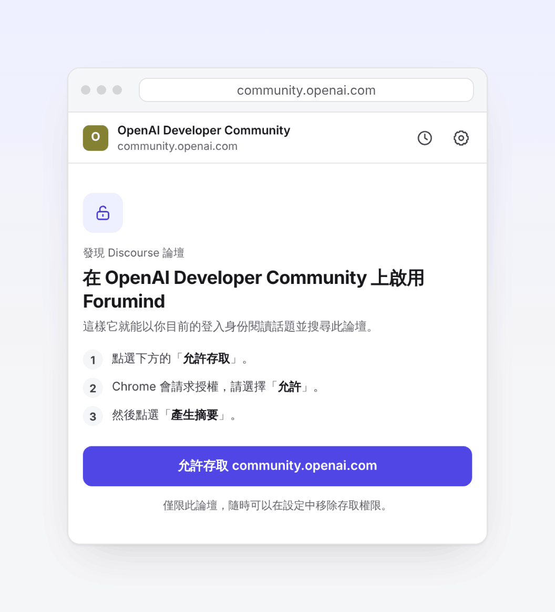

<h1 align="center">
  <picture>
    <source media="(prefers-color-scheme: dark)" srcset="assets/brand/wordmark/discoursecopilot-wordmark-horizontal-on-dark.svg">
    
  </picture>
</h1>

<h3 align="center">逛 Discourse 論壇，不用再爬文。</h3>

<a href="README.md">English</a> · <a href="README.zh-CN.md">简体中文</a> · <b>繁體中文</b>

  一鍵爬文摘要，針對整串討論追問（連是哪一樓說的都告訴你），還能讓 AI 幫你搜遍整個論壇，回答附帶原始貼文連結。

  
  
  
  
  
  

  
  &nbsp;
  

  <a href="https://github.com/kccarlos/DiscourseCopilot"><b>⭐ 在 GitHub 上點個 Star</b></a>
  ，第一時間收到新版本。不花錢，還能讓更多逛論壇的人發現它。

DiscourseCopilot 是一個免費、開源的 Chrome 擴充功能。它在瀏覽器側邊欄裡開啟，配合任何以 Discourse 架設的論壇使用，並且**用你自己的論壇登入狀態讀文**。AI 由你自己提供（用你自己的 API 金鑰，或者跑在你電腦上的本機模型），**擴充功能本身沒有伺服器、沒有帳號、沒有任何分析**。

## 支援哪些論壇

所有基於 [Discourse](https://www.discourse.org) 架設的論壇都可以用，不管是什麼網域，也包括需要登入的私有社群。下面是一些常見的 Discourse 論壇：

[美卡論壇 US Card Forum](https://www.uscardforum.com)、[LINUX DO](https://linux.do)、[Discourse Meta](https://meta.discourse.org)、[OpenAI 開發者社群](https://community.openai.com)、[Cursor 論壇](https://forum.cursor.com)、[Hugging Face 論壇](https://discuss.huggingface.co)、[PyTorch 論壇](https://discuss.pytorch.org)、[Python 社群](https://discuss.python.org)、[Rust 使用者論壇](https://users.rust-lang.org)、[Swift 論壇](https://forums.swift.org)、[Obsidian 論壇](https://forum.obsidian.md)、[Home Assistant 社群](https://community.home-assistant.io)、[Docker 社群論壇](https://forums.docker.com)、[Unity 討論區](https://discussions.unity.com)、[Godot 論壇](https://forum.godotengine.org)、[n8n 社群](https://community.n8n.io)，以及成千上萬個其他社群。

不確定某個論壇是不是 Discourse？開啟它，點一下 DiscourseCopilot 圖示，側邊欄會告訴你。以上論壇僅作舉例，DiscourseCopilot 與它們沒有任何關聯。各論壇自己的規則仍然有效，機器人驗證比較嚴格的論壇可能會攔截部分請求（見[常見問題](docs/zh-TW/faq.md)）。

## 為什麼好用

- **不用爬文。** 幾百樓的貼文，一鍵讀完，直接看要點。
- **針對整串討論提問。** 每一則回覆都會放進對話上下文，而不是只搜幾筆相關結果，所以你可以問「大家最後怎麼定的？」或者「哪一樓提到了解決辦法？」，回答會告訴你是哪一樓說的，方便回去核對。
- **搜遍整個論壇。** 提一個問題，AI 會一步一步地搜尋、閱讀相關貼文，最後給出帶編號來源的回答，點一下就能跳到原始貼文。不用當伸手牌，直接問 AI。
- **你能看到的，它都能讀。** 用你的論壇登入狀態讀文和搜尋，只有登入使用者（或達到一定等級）才能看的貼文也包括在內，這些內容是搜尋引擎和公開的 AI 工具看不到的。
- **不給論壇添負擔。** 摘要和對話按貼文儲存在本機；貼文有了新回覆，只抓取新增的部分，不會重複爬整串討論。
- **背景執行，不用等。** 摘要和提問都在背景跑，你可以接著看別的貼文，回來再看結果。
- **AI 隨你選。** OpenAI、Anthropic（Claude）、Google Gemini 等都支援，也可以用電腦上免費執行的本機模型。免費額度被限速了？在輸入框裡一鍵換個模型接著用。
- **介面支援中文。** 提供繁體中文、簡體中文和英文，跟隨瀏覽器語言自動切換。

## 能做什麼

<table>
  <tr>
    <td width="50%" valign="top">
      
      
<strong>產生摘要與追問</strong> 
      一鍵爬文，看到原始貼文內容、大家的回應和關鍵結論，再長的貼文也行。然後繼續追問，AI 能看到整串討論，會告訴你是哪一樓說的。

    </td>
    <td width="50%" valign="top">
      
      
<strong>全站搜尋</strong> 
      提一個問題，AI 會搜尋論壇、閱讀最相關的貼文，每一步你都看得到，最後給出帶 [S1] 這樣來源編號的回答，點一下就跳到原始貼文。回答下面可以直接追問。

    </td>
  </tr>
  <tr>
    <td width="50%" valign="top">
      
      
<strong>按論壇分組的歷史紀錄</strong> 
      儲存的摘要、對話和回答按論壇分開，不同社群不會混在一起。想長期保留的可以點 <strong>保留</strong>。

    </td>
    <td width="50%" valign="top">
      
      
<strong>快速設定</strong> 
      選供應商、貼上金鑰、點 <strong>測試並儲存</strong>。有問題會馬上提示你。

    </td>
  </tr>
  <tr>
    <td width="50%" valign="top">
      
      
<strong>深色模式</strong> 
      自動跟隨系統的淺色或深色主題。

    </td>
    <td width="50%" valign="top">
      
      
<strong>可以自己調的設定</strong> 
      全站搜尋的深度、長篇討論讀多少頁、歷史紀錄保留多久，都可以自己選。

    </td>
  </tr>
</table>

## 三步上手

**1. 安裝擴充功能。**
開啟 [Chrome 線上應用程式商店裡的 DiscourseCopilot](https://chromewebstore.google.com/detail/discoursecopilot/dpngnaiiofobfjleabbhnfmdflddnhac)，點 **加到 Chrome**；用 Microsoft Edge 的話，開啟 [Edge 附加元件商店](https://microsoftedge.microsoft.com/addons/detail/cjbpgigbkfdcgdmlpifklpoklpnbkhmp)。然後點工具列上的拼圖圖示，固定 **DiscourseCopilot**。（商店版本需要審核，想馬上用最新版可以[從 GitHub 安裝](docs/zh-TW/guide.md#從-github-安裝最新版)。）

**2. 連線一個 AI 供應商。**
點 DiscourseCopilot 圖示開啟側邊欄，選供應商、貼上 API 金鑰，點 **測試並儲存**，會自動選一個又快又便宜的模型。**沒有 API 金鑰？** 去 [Google AI Studio](https://aistudio.google.com/apikey) 一分鐘就能免費拿到一個 Gemini 金鑰。不知道選哪家，見[選擇 AI 供應商](docs/zh-TW/guide.md#選擇-ai-供應商)。

**3. 開啟一個論壇貼文，授權存取，然後點「產生摘要」。**
開啟任意 Discourse 論壇的貼文（如果需要登入，先登入），點 DiscourseCopilot 圖示。第一次在某個論壇使用時，點 **允許存取**，再在 Chrome 彈出視窗裡選 **允許**，每個論壇只需授權一次。之後點 **產生摘要**，在底部的輸入框裡繼續追問就行。

## 隱私優先

- **沒有分析、沒有追蹤、沒有帳號，也沒有 DiscourseCopilot 伺服器。** 什麼都不會發給開發者，因為根本沒有地方可發。
- **資料只存在你的瀏覽器裡。** 設定、API 金鑰、儲存的摘要、對話和回答都只儲存在你的電腦上，隨時可以刪除。
- **只有兩類網路請求：** 你允許的論壇（按論壇逐個授權，用你在論壇上的登入狀態），以及你選的 AI 供應商（用你自己的金鑰）。**用本機模型（Ollama 或 LM Studio）時，資料完全不離開你的電腦。**

詳見[隱私說明](docs/zh-TW/guide.md#隱私說明)和[隱私權政策](PRIVACY.md)（英文）。程式碼完全開源，你可以自己檢查。

## 了解更多

- [使用指南](docs/zh-TW/guide.md)：側邊欄、全站搜尋、AI 供應商和 Ollama、每一項設定
- [常見問題](docs/zh-TW/faq.md)：需要登入的論壇、限速、機器人驗證、復原刪除、費用等

## 開發者

- 建置、測試和程式碼結構：[DEVELOPMENT.md](DEVELOPMENT.md)（英文）
- 參與貢獻：[CONTRIBUTING.md](CONTRIBUTING.md)
- 報告安全問題：[SECURITY.md](SECURITY.md)
- 每個版本的更新內容：[CHANGELOG.md](CHANGELOG.md)

歡迎提 Issue 和 PR，中文英文都可以。

## 授權條款

Apache License 2.0，見 [LICENSE](LICENSE)。作者 [kccarlos](https://github.com/kccarlos)。

如果 DiscourseCopilot 幫你省了時間，歡迎在 GitHub 上[點個 ⭐ Star](https://github.com/kccarlos/DiscourseCopilot)，這能幫助更多逛論壇的人發現它。
